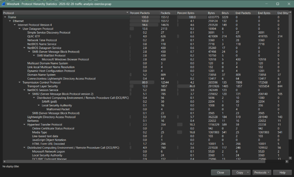
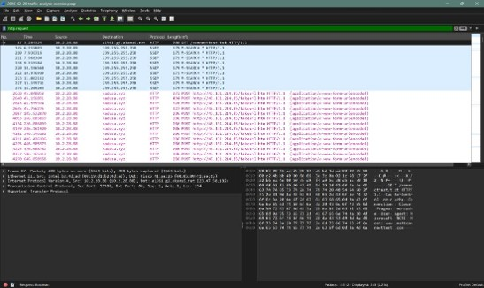
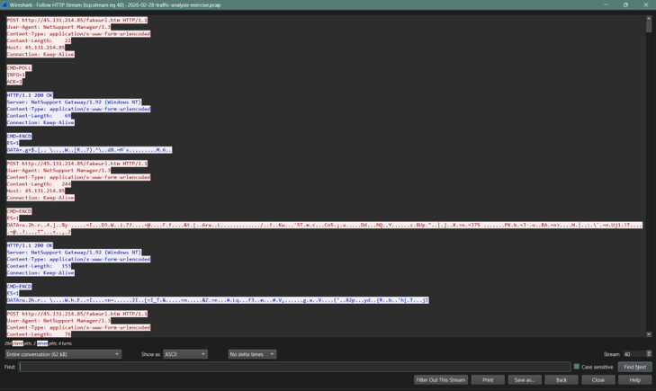
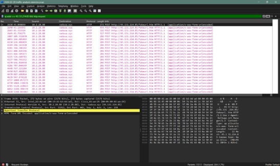
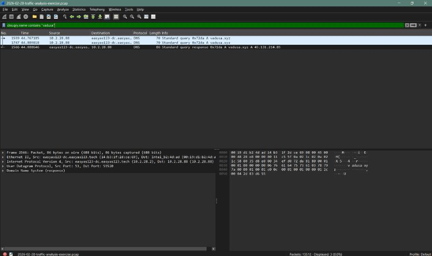

# Network Traffic Analysis & Threat Detection

## Project Overview

This project examines a network packet capture using Wireshark to investigate unusual network activity and identify potential security threats. The analysis focuses on HTTP communication, DNS resolution, Windows network protocols, and repeated connections to an external server.

The capture contained 15,512 packets. By filtering traffic, examining packet details, and following HTTP streams, I identified NetSupport-related communication that warranted further investigation.

The goal was to document what the network evidence showed without assuming that every unusual connection was malicious.

## Tools and Skills

- **Wireshark:** Packet inspection, protocol filtering, and HTTP stream analysis
- **Network Protocols:** TCP/IP, HTTP, DNS, SMB2, Kerberos, and LDAP
- **Traffic Analysis:** Connection investigation, timestamp comparison, and polling-pattern identification
- **Security Investigation:** Indicator documentation, incident timelines, and recommendations

## Investigation Process

### 1. Initial Traffic Review

I began by examining Wireshark's Protocol Hierarchy and Conversations views to understand the captured traffic and identify active devices.

The investigation focused on workstation `10.2.28.88`, its internal domain controller at `10.2.28.2`, and external connections requiring further analysis.

### 2. Suspicious HTTP Communication

I identified repeated HTTP POST requests from `10.2.28.88` to external IP address `45.131.214.85`.

The requests targeted `/fakeurl.htm` using TCP destination port 443. Despite the port commonly being associated with HTTPS, the inspected traffic contained readable HTTP.

### 3. NetSupport-Related Activity

Following the HTTP stream revealed several notable fields:

- `User-Agent: NetSupport Manager/1.3`
- `Server: NetSupport Gateway/1.92 (Windows NT)`
- `CMD=POLL`
- `CMD=ENCD`
- `HTTP/1.1 200 OK`

These observations were consistent with remote administration-related communication. However, the packet capture alone could not determine whether the software or activity was authorized.

### 4. Repeated Communication Pattern

I compared the relative timestamps of selected HTTP POST requests and found a sequence occurring approximately every 60 seconds.

This regular interval suggested automated polling and was consistent with possible command-and-control beaconing, although legitimate software can also communicate periodically.

### 5. DNS Investigation

DNS analysis showed that the workstation queried `vadusa.xyz` and received the external IP address `45.131.214.85` from the internal DNS server.

The workstation then began HTTP communication with that destination, connecting the DNS activity to the subsequent requests.

## Key Findings

| Finding | Observation |
|---|---|
| Internal workstation | `10.2.28.88` |
| External destination | `45.131.214.85` |
| Domain | `vadusa.xyz` |
| HTTP resource | `/fakeurl.htm` |
| Destination port | TCP 443 |
| Application indicators | NetSupport Manager and Gateway |
| Communication pattern | Selected HTTP requests approximately 60 seconds apart |

## Investigation Limitations

This project was based on an offline PCAP investigation. Endpoint logs, installed software records, and authorization information were not available.

The findings identify suspicious communication patterns but do not independently confirm malware execution, unauthorized remote access, or data exfiltration.

## Investigation Report

The full report includes the methodology, Wireshark display filters, packet timeline, supporting evidence, and recommended investigation steps.

[Full Investigation Report](Network_Traffic_Investigation.pdf)

## Dataset Attribution

**Source:** Malware-Traffic-Analysis.net  
**Dataset:** February 28, 2026 Traffic Analysis Exercise

